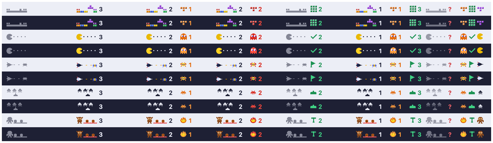
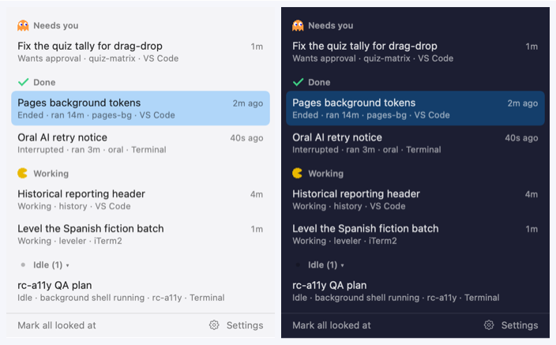

# 1UP

A macOS menu bar app that shows the state of every Claude Code session on your Mac: which ones are
working, which need you, and which finished while you were elsewhere. Five arcade themes, one layout.



The scene plays while sessions work. An orange icon means a session needs you (it turns red after two
minutes). A green icon means a turn ended that you haven't looked at yet. Click the item for the panel:



Nothing to configure, no permissions, no network. It reads the status files Claude Code already writes.

## Install

Requires macOS 14 or later and Claude Code 2.1.261 or later.

**Download.** Paste this in a terminal. It fetches the latest release into Applications and opens it:

```sh
curl -fsSL -o /tmp/1UP.zip https://github.com/hoberobin/1up/releases/latest/download/1UP.zip \
  && ditto -x -k /tmp/1UP.zip /Applications && open /Applications/1UP.app
```

If you download `1UP.zip` from the [Releases page](https://github.com/hoberobin/1up/releases) with a
browser instead, macOS will say it can't verify the app the first time you open it, because the build is
not notarised yet. Open System Settings › Privacy & Security, scroll down, and click **Open Anyway** once.

**Build it yourself.** With Xcode's command line tools installed:

```sh
git clone https://github.com/hoberobin/1up.git && cd 1up && tools/make-app.sh --open
```

That writes `build/1UP.app`, opens it, and 1UP offers to move itself to Applications.

On first launch 1UP shows a welcome card anchored to the menu bar item. Click the item for the panel,
right-click for the menu (theme, settings, quit). Clicking a Done row, or "Mark all looked at", clears it.

## What it reads and writes

- **Reads** `~/.claude/sessions/*.json` (never the `.key` files or sockets beside them) and, from the end
  of each session's transcript, only the session title and turn-end records. Message bodies are never read.
- **Reads** the environment of your own Claude Code processes to find extra config folders
  (`CLAUDE_CONFIG_DIR`) and the terminal app a session runs in. Nothing from it is stored.
- **Writes** `~/Library/Application Support/1UP/state.json` (when you last looked at each session), a
  7-day log of state changes in `~/Library/Logs/1UP/`, and its preferences.
- **No network, no macOS permissions.** "Check for Updates…" opens the Releases page in your browser.

Not covered: Claude Code on the web, the desktop app's chats, `claude -p` scripts, and the VS Code
extension's chat panel. CLI sessions inside VS Code's terminal are covered.

## When something looks wrong

Settings › **Check my setup** says which folders were found, which Claude Code versions are running, and
whether the version has been verified. A row showing "?" means a status file had a shape 1UP didn't
recognise; it is listed rather than hidden so a waiting session can't disappear. If 1UP disagrees with
what a terminal shows, open an issue with the day's log file from `~/Library/Logs/1UP/`.

## Develop

`docs/SPEC.md` is the source of truth (`docs/SPEC.html` is the same spec with the live preview).
Behaviour changes update the spec in the same PR.

```sh
swift build                   # core, app binary and oneup-dump
swift test                    # reducer fixtures, engine, themes, captured real files
swift run oneup-dump          # one line per session every second, no UI
tools/make-app.sh --zip       # build/1UP.app (universal, with icon) and build/1UP.zip
node tools/render-themes.mjs  # rebuild Resources/Themes from the spec's scene code (--check compares instead)
tools/capture-fixtures.sh     # copy scrubbed status files + transcript tails into Tests/.../Fixtures/<version>
.build/release/oneup-app --render-all docs/images   # every screenshot in this README
```

Or from Xcode: `brew install xcodegen && xcodegen && open 1UP.xcodeproj`.

Layout: `Sources/OneUpCore` (pure logic, tested), `Sources/OneUp` (AppKit/SwiftUI shell),
`Sources/oneup-dump`, `Resources/Themes/<id>/` (PNG layers + theme.json, no code), `tools/`.

**Releasing.** Push a tag like `v1.0.1` and the Release workflow runs the tests, builds the universal
app, and attaches `1UP.zip` to a GitHub Release. When Claude Code ships a new version, run
`tools/capture-fixtures.sh`, check the tests still pass, and bump `newestTested` in `SetupCheck.swift`.

## Not yet in this build

Signing, notarisation and Sparkle updates (spec milestone M5) wait on an Apple Developer ID. Until then
the one-time "Open Anyway" step above applies to browser downloads, and updates are manual.

## Licence

MIT. See [LICENSE](LICENSE).
